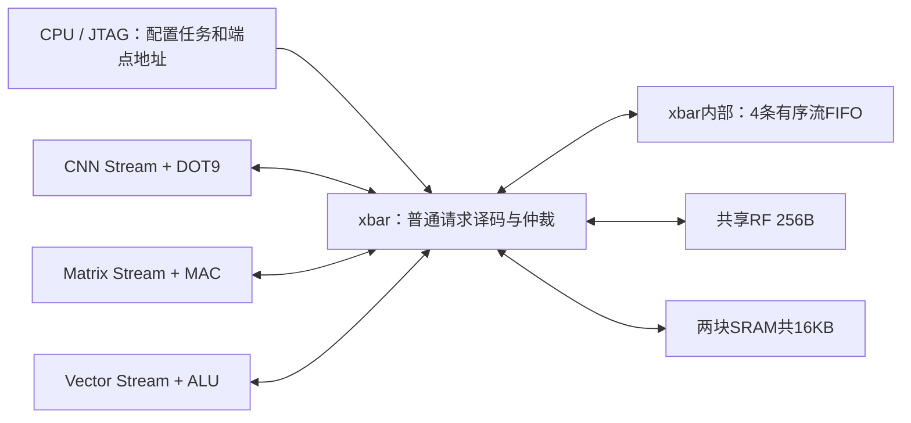

# xbar内的通用流转发


当前CNN、Matrix、Vector可以通过同一个xbar直接交换32bit数据。单元外部没有互相连接的专线，也不要求先把数据写进共享RF。RF和两块SRAM仍作为可选数据源/目的地。



## 通道与协议

| 通道 | 端点基址 | 缓冲 |
|---|---|---|
| 0 | 0x80006000 | 16×32bit |
| 1 | 0x80006100 | 16×32bit |
| 2 | 0x80006200 | 16×32bit |
| 3 | 0x80006300 | 16×32bit |

每条通道是一条有序FIFO。任意单元的输出地址选定通道即为生产者；另一单元的输入地址选择相同通道即为消费者。地址低8bit是回绕游标，不代表256B实际存储；所有对齐地址访问同一通道队列。普通内存地址仍保留原语义。

一次获准写入推入一个32bit字，一次获准读取弹出一个字。写字节使能之外的字节清零；硬件不自动压缩字节、复制数据、量化或转换精度。FIFO满时写请求等待，空时读请求等待，已获准请求下一周期回复。每通道每周期最多一次写和一次读，不同通道可以并行。

总FIFO payload为256B，独立于256B共享RF与128B透明SRAM读缓存。FIFO没有全数组复位，复位清除占用计数和指针。`xbar_stream.sv`独立实现流路由及读写轮转仲裁，`xbar.sv`统一合并普通端口的存储/流回复。

软件可读0x40000060查询通道数和深度（高16位4、低16位16），0x40000064查询端点基址。C头文件提供`NPU_STREAM_ENDPOINT(channel)`等定义。

## 单元接口和并行

普通master分配为：0 CPU数据、1 CNN、2 Vector、3 Host/JTAG SBA、4 CPU取指、5 Matrix。CNN和Matrix不再共用一个端口，相关互斥启动限制已删除。共享RF内部还有RF-only写回入口，作为第7个请求者；RF gather仍是3×32bit。

计算核接口保持纯算术。供数模块仍使用普通地址/req/gnt/rvalid端口：

- CNN：输入/权重基址可以是流端点，窗口缺字按实际请求顺序取数；最终INT32输出可写流端点。部分和仍在共享RF。流输入的排列必须匹配窗口补充顺序，不能把它当成可随机重读的完整图像。复杂窗口复用时仍可选RF/SRAM。
- Matrix：A、B及D地址均可选流端点。循环、转置及复用不会让FIFO自动重放数据；上游必须按实际取数顺序发送所需字。INT8/INT16解包继续由供数器根据字节位置执行。
- Vector：源/目的地址可选流端点；保持通用运算程序与打包规则。它按完整32bit字接收数据，不能把上游packed U8自动理解为四个独立INT32输入。

先提交消费者，再提交生产者，可使两者在硬件反压下流水执行。可用不同通道连接CNN→Vector→Matrix。多个消费者读同一通道意味着竞争弹出数据，不是广播；广播/复制必须由软件显式安排。

例如，通过通道0把Vector输出接入Matrix的A：

```c
struct npu_gemm_descriptor g = {
    .a = NPU_STREAM_ENDPOINT(0), .b = weights, .d = output,
    .m = 1, .n = 1, .k = 1, .flags = 0
};
struct npu_vector_descriptor v = {
    .a = input, .b = 0, .d = NPU_STREAM_ENDPOINT(0),
    .len = 1, .op = NPU_V_MUL32 | 0x80u, .scalar = 2
};
/* Check return codes, then wait for completion tickets before reusing buffers. */
npu_gemm_start(&g);
npu_elementwise_start(&v);
```

## 软件约束与验证范围

每个任务的生产/消费字数必须匹配。软件避免循环等待、自读自写的空FIFO环路、未完成任务的通道复用，以及把流端点当成随机访问内存。发生中途错误后可能存在残留数据，需要先停止数据流并执行系统复位，不能假设队列自动回滚。

CPU/JTAG可访问流端点，但读取空通道或写入满通道会阻塞，不能靠读端点来轮询可用性。调试时优先读取普通状态寄存器；SBA总线错误反馈仍受现有DM限制，强行中断未获准SBA事务可能需要POR。系统复位只清除已接受事务后生效，保留原来的调试复位协议。


## 当前验证入口

默认配置和性能使用[项目首页](../../README.md)；当前版本的功能、综合、最终PNR及检查证据统一见[报告索引](../reports/README.md)。
