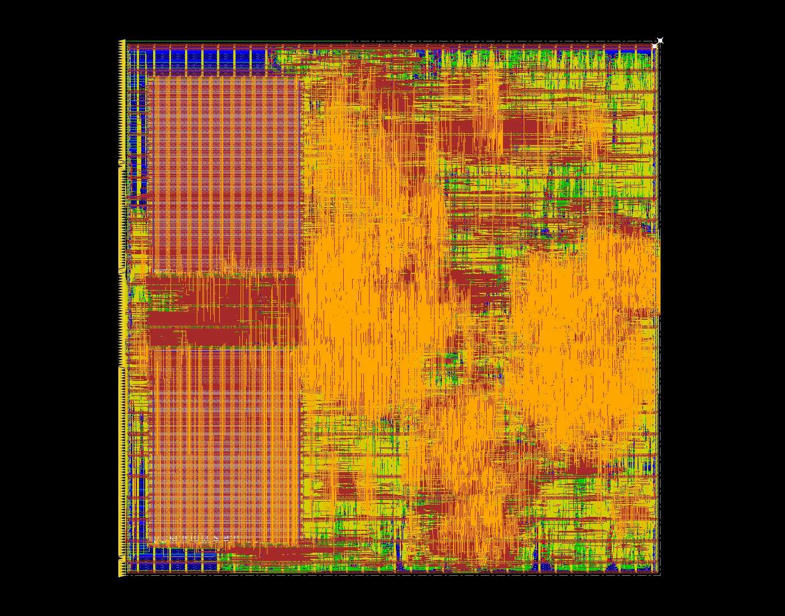
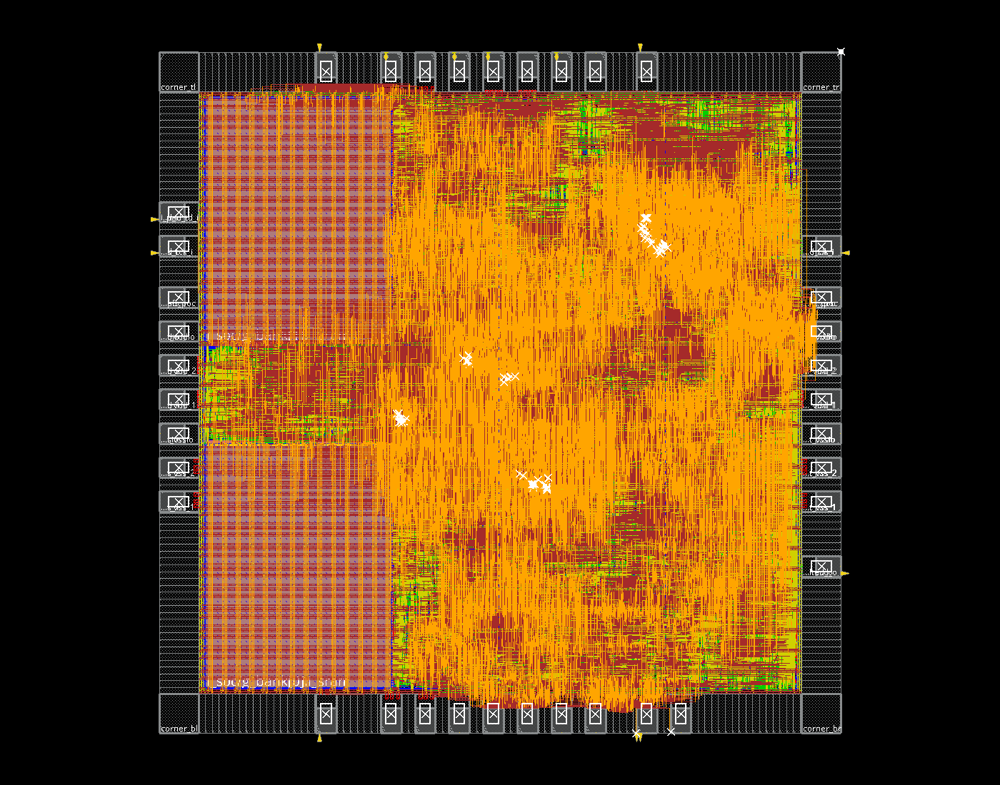

> 2026-11-09 [Lab5 后续流程实跑](../../docs/lab5-all4.md)：V2LVS、Seal Ring、Dummy、LVS/ERC、天线和WB已执行。教学容差LVS为CORRECT，天线/WB为0；仍有270处M1间距违规、ERC残项和尺寸超限，未完成验收。

> 最新RF 1R1W最终r3后端见[完整报告](../../docs/rf1r1w-die1950-signoff.md)：1950µm、2.632349mm²核心非filler，50MHz setup/hold +0.468/+0.018ns；Calibre驱动修复M2/WB间距，完整课程检查及原始残项均保留。

> 最新1950µm布局布线及Lab 5完整检查见[报告](../../docs/die1950-signoff.md)：Seal Ring外框1980µm，50MHz setup/hold +0.592/+0.019ns；课程DRC排除后0、教学容差LVS CORRECT、天线/WB 0，ERC残项待评审。以下2000µm及更早运行保留为历史记录。

> 2026-11-08 当前 4/4/4 队列的[完整含 PAD 后端结果](../../docs/area26-all4-pnr.md)：2×2mm²，布线后核心非 filler 2.638167mm²，50MHz setup +0.529ns、hold +0.020ns；两条原生 IO 电源轨提示保留。以下更早结果属于历史快照。

> 当前vector已改为通用指令程序，见[设计说明](../../docs/vector-program.md)与[当前报告](../../reports/vector_program_validation.json)。以下此前PPA/布局布线结果不代表新RTL。

最新[完整含PAD后端结果](../../docs/window-prefetch-pnr.md)：2×2mm²，核心非filler面积2.738033mm²，TT 50MHz的setup/hold均收敛；原生IO电源轨的两条工具提示单独保留。

> 最新逻辑精简综合：512B RF与8/8/16队列不变，Cell Area **2.876480mm²**，50MHz setup **+4.0017ns**；见[验证报告](../../reports/logic_trim_validation.json)。下文旧无PAD后端表格属于精简前快照。

# 独立计算单元的 TSMC180 综合

RF容量及三组FIFO深度默认读取 `npu/build_config.json`。CNN输出原始INT32，后处理由vector完成；当前结果见[报告](../../reports/regfile_vector_validation.json)和[说明](../../docs/regfile-vector.md)。本轮不包含布局布线、PAD或板级验证。

从仓库根目录运行（目录必须不存在）：

```sh
/usr/bin/python3.12 npu/eda/tsmc180/prepare_run.py --out ../eda-runs/NEW_RUN --effort low --synth-period 16 --report-period 20
genus -no_gui -batch -files ../eda-runs/NEW_RUN/synth.tcl > ../eda-runs/NEW_RUN/launcher.log 2>&1
/usr/bin/python3.12 npu/scripts/run_gate.py --run ../eda-runs/NEW_RUN --suite latency --tag NEW_GATE_TAG --max-cycles 20000
/usr/bin/python3.12 npu/scripts/run_gate.py --run ../eda-runs/NEW_RUN --suite burst --tag NEW_BURST_GATE_TAG
```

`--cnn-queue-depth`、`--matrix-queue-depth`、`--vector-queue-depth` 均可选1/2/4/8/16。`--rf-bank-words`可选32/64/128/256，总RF容量为该值×8B。更改容量后应使用相同的 `NPU_RF_BANK_WORDS` 环境变量重新生成固件。最新五组源清单、库哈希、约束、网表与rpt在 `../eda-runs/20261103-cnn-vector/`。用 `collect_regfile_vector.py --run ../eda-runs/20261103-cnn-vector --selected <配置目录名>` 核对记录。

输入冻结公开RTL、CPU include和技术wrapper，外部使用TSMC180 TT标准单元及RA1SHD_2048x32M8 SRAM库，不将PDK拷入仓库。两片真实8KB宏保留；setup uncertainty0.52ns、hold uncertainty0.2ns、试验性IO delay0.5ns、输出load0.2pF。系统16ns优化/20ns报告，TCK100ns，与系统异步。

`reports/area.rpt` 是含宏的Cell Area；`qor.rpt/timing.rpt/clocks.rpt` 是报告周期下的时序；`check_design.rpt/unresolved.rpt` 是结构检查；`optimized.v/sdc/db` 是最终映射输出；源码/库manifest防止结果混用。不要将Net Area相加后当作可放置core面积。

网表功能仿真用真实标准单元与宏模型，零延迟、无SDF、关闭timing check，默认不强制20k性能阈值。可显式传 `--max-cycles 20000` 检查该目标；当前选定配置的单图推理、含输入与连续流平均均低于20k。功能验证不代替布线后时序。

物理规划按2mm×2mm边界、约3mm² Cell Area预算记录在manifest中；该字段是规划目标，不表示本轮已完成floorplan或布线。

## 核心布局布线

使用已经完成综合且源码哈希匹配的结果，新建独立目录：

```sh
/usr/bin/python3.12 npu/eda/tsmc180/prepare_pnr.py --synth ../eda-runs/20261103-cnn-vector/rf64-q8 --out ../eda-runs/NEW_PNR
/usr/bin/python3.12 npu/eda/tsmc180/run_pnr.py --run ../eda-runs/NEW_PNR
```

流程依次执行init、place、pgfix、cts、route、finish、cleanup，也可用`--stages`指定尚未执行的阶段。每阶段保留独立日志、实际执行的Tcl快照、输入哈希、checkpoint及DRC/连通性/时序报告。阶段命令完成不代表检查通过；必须核查报告。默认2mm×2mm裸核心边界、约20µm核心边距、两块真实SRAM、METAL2～6信号布线、50MHz系统时钟和10MHz异步JTAG。程序不加入PAD，也不裁剪host/DMA端口。

当前实验目录为`../eda-runs/20261103-cnn-vector/rf64-q8/pnr`。标准单元/SRAM TT时序库、六层金属LEF和本地RC captable均冻结哈希；没有改写PDK。宏LEF引用了本六层工艺未定义的METAL7/8 OBS，Innovus会忽略这些不存在的层；缺少的宏天线属性也必须作为物理验证限制记录，不能视为流片签核。

`cleanup`使用工具的`editTrim`清除电源网上的电气悬空尾段，再次验证连通性并重新提取RC。全部阶段完成后，可用`collect_pnr.py --run <目录> --out npu/reports/regfile_pnr_validation.json`核对输入与报告哈希。`run_gate.py --netlist <目录>/outputs/routed.v`可对导出的布线网表进行无SDF功能检查。


### 本次实际结果

当前512B RF、matrix/vector/CNN FIFO=8/8/16配置完成全部七阶段。保持RTL、输入网表及库文件哈希一致，未更改RTL。

| 项目 | 最终值 |
|---|---:|
| die / core边界 | 2000×2000µm / 约1959×1959µm |
| 实际标准单元矩形面积（含时钟/tie/tap/天线等辅助单元） | 2.254273mm² |
| 两块SRAM矩形面积 | 0.802887mm² |
| 不含filler的实际面积合计 | **3.057160mm²** |
| filler矩形面积（单独统计） | 0.690777mm² |
| TT、50MHz setup WNS / TNS | +1.262ns / 0 |
| TT、50MHz hold WNS / TNS | +0.008ns / 0 |
| 几何DRC / 信号连通性 / 电源连通性问题 | 0 / 0 / 0 |

3mm²预算已超约1.9%。综合Cell Area为2.998059mm²，而上表是实际LEF单元矩形面积，包含后端新增辅助单元，SRAM的时序库面积与LEF矩形面积也存在差异。不能将二者差额全部解释为缓冲面积，也不能把filler面积计入逻辑面积比较。

过程记录：CTS后46条hold违例，最差−0.554ns；布线后最差−0.564ns，插入49个缓冲后修复。PG连接先补齐SRAM顶层电源环，再清除274个电源尾段，最后独立检查均为0。最终setup关键路径从CPU取指寄存器到NMC的cache_hits统计计数器。hold余量只有8ps；本次为TT单角RC captable分析，没有SI、多角及完整PAD/封装签核。

[机器可核对报告](../../reports/regfile_pnr_validation.json)包含全部阶段、报告与输出哈希。产物为`checkpoints/cleanup.enc`、`outputs/cleanup.def`、`outputs/routed.v`、`outputs/routed.spef`、`outputs/routed.sdf`。通过GUI可恢复checkpoint查看完整布局与布线。



截图来自`cleanup.enc`，对应源信息见[截图来源](../../docs/images/regfile-pnr-source.json)。


## 完整9 PAD后端

复用此前完整后端的native IO、供电、CTS、布线及合并GDS导出流程，脚本已冻结于`fullchip/`。原始脚本来源及哈希见`fullchip/reference.json`。

```sh
/usr/bin/python3.12 npu/eda/tsmc180/prepare_chip.py --core ../eda-runs/20261104-rf-gather/asic --out ../eda-runs/NEW_CHIP
genus -no_gui -batch -files ../eda-runs/NEW_CHIP/scripts/synth_chip.tcl > ../eda-runs/NEW_CHIP/mynpu/chip_synth/launcher.log 2>&1
/usr/bin/python3.12 npu/scripts/run_chip_gate.py --run ../eda-runs/NEW_CHIP --tag NEW_CHIP_MAPPED
/usr/bin/python3.12 npu/eda/tsmc180/run_fullchip.py --run ../eda-runs/NEW_CHIP --macro-plan left
```

默认保留原核心映射，避免在添加外壳时重新映射整个核心。`--remap-core`仅用于对照实验。

默认die为2000×2000µm，core约1740×1740µm，核心电源环宽4µm、间距2µm。两块SRAM放左下角R180、左上角R0，信号边朝内；halo按照LEF中5.2µm的OVERLAP内缩及信号边的逃线需求设置。`--macro-plan diagonal`为对角旋转对照；`--compact-core`启用122µm边距/2µm环的紧布局试验，不应与默认结果混用。

信号PAD为6输入、3输出：clk/rst/boot_ready、JTAG四线、IRQ和debug_halted。另有28个电源/地/POC PAD、4角、native IO filler及bond pad。程序、模型、输入通过JTAG SBA写入，host并行及外部DMA流端口不引出。软件仍可使用片上DMA；9 PAD封装不能使用未引出的外部RX/TX接口。

标准单元放置后，按实际端点位置，把9个信号PAD分配到32个合法槽位，求最小总Manhattan距离的离散匹配；电源PAD固定对称分布。此目标近似core-facing pin位置，不等同于全局布线/封装/IR的无条件最优。结果写入`outputs/pad_moves.json`，IO filler和bond窗口随位置更新。

流程可按`--stages 01 02 03 04 04b 05 06 07`分段执行。每段有日志、实际脚本快照与输入哈希。`collect_fullchip.py --run <目录> --out <报告.json>`核对物理结果。旧专用vector post版本目录为`../eda-runs/20261103-logic-trim/fullchip`；此前紧布局和合法化失败记录保留在`../eda-runs/20261103-regfile-fullchip*`。

JTAG约束为真实10MHz：TDO下降沿更新、外部上升沿采样；系统目标50MHz。native IO供电轨位于库GDS中，工具的“no routing”提示应与core普通布线连通问题分开记录，并检查IO几何及合并GDS。不能通过给IO OBS重复布电源来隐藏提示。最终结果仍需独立核对DRC、信号/核心PG连通性、setup/hold和原生IO边界；这些检查不代替 foundry DRC/LVS/ESD/EMIR签核。

旧专用vector post版本8阶段命令完成，**物理未收敛**：最终密度95.38%，DRC124，setup WNS/TNS −0.566/−21.360ns，hold −0.033/−0.034ns。工具两次报告密度超出90%的优化限制。天线和核心VDD/VSS连通性通过；regular connectivity另有VDDPST/VSSPST两项上述native轨提示。实际标准单元矩形2.124657mm²、两块SRAM0.802887mm²，合计2.927544mm²（不含filler与IO）；native IO几何并集0.8671mm²。IO/bond重叠，不能直接累加所有物理单元矩形作为占地。

九引脚映射与布线后网表测试均通过34项JTAG检查，未反标SDF。合并GDS的结构引用、接口、宏/PAD数量及导出文件完整性检查与IO几何检查单列，均不能代替foundry签核。详见[历史完整报告](../../reports/fullchip_logic_trim_validation.json)。



[截图来源](../../docs/images/logic-trim-fullchip.source.json)。该次冻结脚本仍保留原始结果；仓库模板已修正PAD优化后`editPin`的自动边界吸附问题，使用INSIDE/MGRID精确放置，独立probe确认9个位置正确。此修复未应用到该次冻结网表，不能用probe结果扣除上述124处DRC。

当前通用vector/256B RF的试跑见[本次后端记录](../../docs/vector-program-pnr.md)与[机器报告](../../reports/fullchip_vector_program_validation.json)：CTS后合法化失败，未完成数据网络详细布线，不能沿用上述历史版本的DRC/时序结果。`04c`为可选CTS后合法化阶段，`05`模板会在布线前检查实际放置合法性。

CNN卷积专用化（CRW2）、FC迁移到Matrix的当前结果见[设计记录](../../docs/cnn-conv-only.md)和[机器报告](../../reports/cnn_conv_only_validation.json)。前述CRW1含PAD试跑属于删除FC之前，本次仅重跑综合与功能回归。

共享RF gather与CNN滑动窗口的当前试验见[设计与测量](../../docs/rf-gather.md)及[本次报告](../../reports/rf_gather_validation.json)。本次没有新的布局布线结果；旧CRW1和删除FC后的CRW2面积/周期均保留为历史基线。


CNN最小计算核与SD91搬运任务见[设计记录](../../docs/minimal-compute.md)，当前综合冻结目录为`eda-runs/20261104-minimal-compute/asic`（与工程目录同级）。源清单包含独立`npu_cnn`和`npu_stream`，比较面积时必须合计两者。旧RF-gather/CRW2报告保留为基线；本轮没有新的含PAD布局布线结论。

```sh
python3.12 npu/eda/tsmc180/prepare_run.py --out ../eda-runs/NEW_RUN/asic --effort low --synth-period 16 --report-period 20
/opt/eda/Cadence/GENUS191/bin/genus -no_gui -batch -files ../eda-runs/NEW_RUN/asic/synth.tcl > ../eda-runs/NEW_RUN/asic/launcher.log 2>&1
python3.12 npu/scripts/run_gate.py --run ../eda-runs/NEW_RUN/asic --suite latency --tag NEW_GATE
```


2026-11-05进一步把Matrix和Vector拆成纯计算模块与外部供数/发射器，详见[结构与周期分析](../../docs/pure-compute.md)和[RTL/宏模型验证报告](../../reports/pure_compute_validation.json)。源列表自动包含`npu_matrix_stream.sv`、`npu_vector_stream.sv`；当前三个计算模块没有地址或任务描述符端口。本轮没有重跑综合或布局布线，上述PPA是其冻结版本的历史结果。


后续[CNN窗口预取与RF并行搬运](../../docs/window-prefetch.md)将默认窗口改为每行3words，并开启NMC的RF专用写回入口；共享RF容量和纯算术源文件未改。该版本的[报告](../../reports/window_prefetch_validation.json)仅包含RTL/宏模型功能与周期；最新PPA见上方完整后端链接。`prepare_run.py`会冻结新配置字段，不能把历史2.666814mm²等当作新版本测量。
