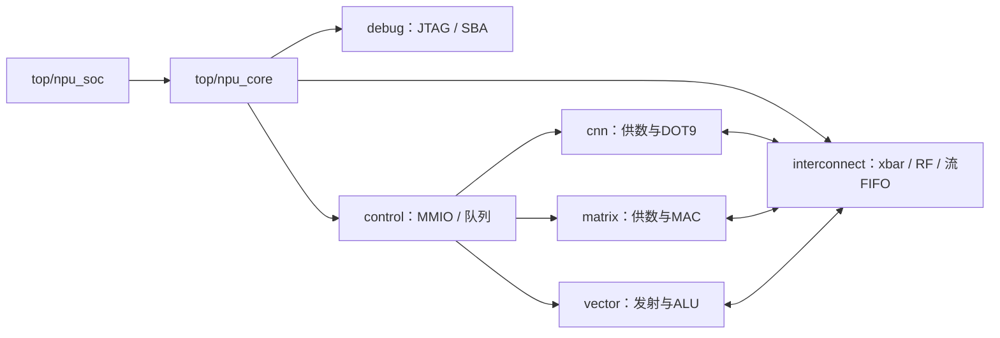

# RTL文件导航

最新 CNN 已改为[显式卷积核地址 SD92](../docs/cnn-kernel-address.md)：地址随任务进入 43bit FIFO，删除 co 寻址；旧固件需重生成，默认镜像已更新。13 组回归通过，默认/共享量化为 29,297 / 26,061 周期/图，尚未重测 PPA。

已[扩大单次任务规模](../docs/task-scale.md)：Matrix K≤256、Vector≤4096 元素、CNN 输入通道≤256，保留原有计算阵列与缓存；九组回归通过，尚未重测 PPA。


当前已[拆分Matrix/Vector/CNN为IRQ16/17/18](../docs/irq-independent.md)，完成与错误均可唤醒WFI，支持运行中确认done及同拍新事件优先。默认固件已重生成，旧WFI镜像需要更新。共享QT01为25,965周期/张，通用Vector为29,298周期/张。本轮RTL有改动，以下旧面积/时序测量不能代表当前IRQ版本，尚未重测PPA。

共享量化固件已加入[完成中断＋WFI等待](../docs/irq-wfi-wait.md)：MNIST **27,432 → 26,092周期/张**，减少4.88%；CPU取指造成的CNN同bank等待4,424 → 2,490拍。RTL/面积不变；通用Vector固件二进制不变。以下周期统计请按报告版本区分。

已补充[18ns＋门控的面积归属与软件阻塞分布](../docs/area18-distribution-and-blocking.md)：最终网表leaf级面积统计、两条软件路径各10张图的CPU/轮询/逐层等待分析及三张图。RTL与固件未为统计改动。

最新[面积压缩结果](../docs/area25-optimization.md)：**2.515488mm²**（含两块SRAM、不含PAD），相比2.846849mm²减少 **11.64%**。采用high综合、自动门控与18ns再优化；50MHz setup slack **+2.0040ns**。全部功能、256B RF和8/8/8队列保留，推理周期不变；未重跑PNR，严格2.5mm²还差0.015488mm²。

此前完成[Matrix、CNN、Vector Stream精简](../docs/streams-optimized.md)：递增寻址、CNN行窗口选择共享、Vector缓冲与地址ALU复用。21组验证通过，默认/共享量化/旧固件分别为29,173 / 27,432 / 30,710周期，均与本轮优化前一致。[最新综合面积与时序](../docs/streams-optimized-area.md)：总面积 **2.846849mm²**（含两块SRAM，不含PAD），50MHz setup slack **+4.0020ns**，本轮未跑PNR。下列数值为各历史版本。

当前Matrix已改为[4×4外积、16个INT32累加器](../docs/matrix-outer4.md)；支持INT8/INT16、转置、尾块及可选量化。旧2.586795mm²综合数据属于点积版；[Stream精简前综合](../docs/matrix-outer4-area.md)总面积 **2.976653mm²**（含SRAM、不含PAD），50MHz setup slack **+4.0012ns**，未重跑布局布线。

[旧点积Matrix版QT01综合](../docs/shared-quant-area.md)：总面积 **2.586795mm²**（含两块SRAM、不含PAD），比量化前同配置增加6.20%；50MHz综合setup slack **+4.0014ns**。未重跑布局布线。

新增[CNN / Matrix 直连的共享可选量化单元 QT01](../docs/shared-quant.md)：默认原始 INT32 旁路，可选量化后32位或字节写回。MNIST实验固件实测27,633周期/张；旧固件仍29,817周期。

当前Vector已改为[单ALU：INT32 / 4×INT8 SIMD](../docs/vector-simd.md)，删除独立轻量ALU。以下含旧版本测量，请按各报告对应源码版本区分。

当前已[删除透明SRAM读缓存](../docs/no-sram-cache.md)，由软件显式管理RF暂存。11组回归通过，10张MNIST仍为29,817周期；SRAM缓存能力报告为零。最新综合总面积 **2.438904mm²**（含两块SRAM、不含PAD），比带缓存版减少4.11%；XBAR **0.417720mm²**。
删除SRAM缓存前的[XBAR仲裁精简](../docs/arbitration.md)：总Cell Area **2.543393mm²**（含两块SRAM、不含PAD），XBAR **0.522962mm²**；相对上一32位Vector版总面积减少9.44%、XBAR减少33.10%。13组回归通过，MNIST仍为29,817周期。
仲裁精简前的32位Vector版[综合面积](../docs/vector32-area.md)：总Cell Area **2.808663mm²**（含两块SRAM、不含PAD），Vector计算与供数 **0.207111mm²**；与宽Vector版相比总面积下降3.57%、Vector下降32.98%。
当前Vector已改为[纯32位VPG2](../docs/vector32.md)：4×32位寄存器、通用高低半积/进位/双字移位，无64位数据通路和组合指令合并。9组回归通过，MNIST为 **29,817周期/张**；旧VPG1固件需重新生成，之前的面积报告为历史版本。
此前并行版本MNIST宏模型实测 **22,219周期/张**（原25,930，降低14.31%），12组回归通过。已加入[Matrix/Vector并行供数与计算](../docs/shared-parallel-operands.md)：共享RF gather、Matrix打包点积并行、Vector第二轻量lane，以及空流FIFO直接转发。下方恢复版本的25,930周期记录作为历史基线保留。
当前配置为Matrix / Vector / CNN任务队列8/8/8、256B共享RF、两块8KB SRAM以及4条16×32bit xbar流FIFO。单元通过流地址转发数据，无CNN到Vector专用连线；独立DMA与NoC已删除。

| 目录 | 文件与职责 |
|---|---|
| `top/` | `npu_soc.sv`：两块SRAM与SoC封装；`npu_core.sv`：CPU、xbar、控制与计算模块连接 |
| `common/` | `npu_addr_pkg.sv`：SRAM/RF/流端点地址及边界；`npu_clock_gate.sv`：ASIC/FPGA时钟门控适配；`npu_rr_select.sv`：无状态掩码轮询选择 |
| `interconnect/` | `xbar.sv`：仲裁、译码、透明读缓存；`xbar_stream.sv`：有序流FIFO；`npu_data_regfile.sv`：8-bank共享RF与gather |
| `control/` | `npu_mmio.sv`：公共CSR、Matrix/Vector任务队列、完成计数和程序配置 |
| `debug/` | `npu_jtag_debug.sv`：TAP/DTM/DM和SBA接入；`npu_debug_boot.sv`：启动引导逻辑 |
| `cnn/` | `npu_cnn.sv`、`npu_cnn_mac.sv`：纯DOT9计算；`npu_stream*.sv`：CNN任务格式、队列、窗口与访存供数 |
| `matrix/` | `npu_matmul.sv`：纯4×4外积MAC；`npu_matrix_stream.sv`：GEMM循环、取数及写回 |
| `vector/` | `npu_vector.sv`：纯整数ALU；`npu_vector_stream.sv`：通用程序发射、临时寄存器和访存 |

`cnn/`中的`npu_stream`专属于CNN，不是全局互连；全局流转发由`interconnect/xbar_stream.sv`完成。CPU、Debug Module及SRAM模型/宏来自工程外部依赖，不复制进此目录。



## 源文件与构建

[files.f](files.f)是唯一的项目RTL清单，使用相对于本目录的路径，先编译package再编译模块。当前20个文件必须各出现一次；新增、删除文件应同步修改该清单。不要使用非递归`rtl/*.sv`扫描，也不要把测试台或生成文件放进生产RTL目录。

```sh
python3.12 npu/scripts/gen_sources.py
```

统一生成：`npu/build/sources.f`（VCS）、`sources.tcl`（Vivado，含8/8/8定义）、`asic_sources.f`（Genus）。外部CPU/调试库的依赖顺序由脚本管理。部分单元回归通过`rtl_sources.rtl_file()`按文件名解析路径，避免各自复制目录映射。

ASIC入口`prepare_run.py`继续生成真实SRAM宏wrapper；`npu_soc.sv`内的模型替换不依赖排版。`prepare_chip.py`、`prepare_pnr.py`及`run_gate.py`可以解析此前平铺目录中的源路径，但仍必须核对原始文件SHA256；路径兼容不豁免RTL变更。

## 本次整理范围

仅移动文件、更新构建路径并添加导航。20个RTL文件移动前后逐字节SHA256一致，模块名、层次、寄存器地址、运算、FIFO深度均保持一致。旧综合、布局布线数据库及报告中的路径作为历史证据保留，不改写成新目录。完整验证见[整理报告](../reports/rtl_layout_validation.json)。

## 当前CNN并行供数

恢复简化前的36B循环窗口（3行各3个32bit字）、两份9B权重缓冲与读返回直通。CNN通过普通xbar端口访问SRAM，另有3×32bit RF gather读取和独立RF写回入口，实现供数、计算和部分和写回重叠。共享RF仍为256B、8个单端口bank，同bank请求需要仲裁。最终结果经通用xbar流FIFO交给Vector，无专用CNN到Vector连线。

本次恢复的20个RTL文件与简化前快照逐字节一致，保留目录整理、`npu_vector_stream`命名和8/8/8队列。实际SRAM宏完整MNIST回归10张、120项检查通过，每张25,930周期；JTAG回归42项检查通过。[验证记录](../reports/restore_parallel_validation.json)。

52,978周期串行版及50,234周期轻量预取版已撤回，实验报告保留；当前不再提供`--cnn-prefetch`开关。此次没有重新综合或布局布线。
